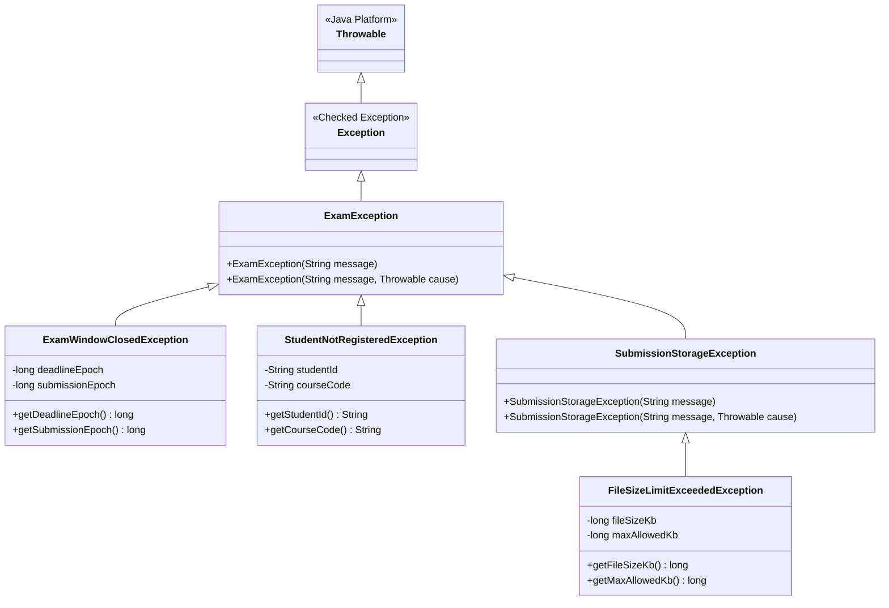
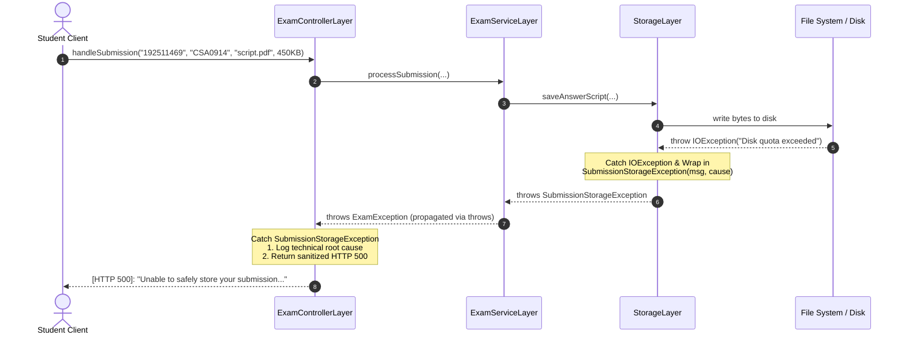

# Task 02: User-Defined Exceptions and Propagation in an Online Examination Portal

**Subject:** Programming in Java (CSA0914)  
**Bloom's Level:** K4 – Analyse  
**Marks Coverage:** Exception Hierarchy, Chaining, Multi-Layer Propagation  
**Repository:** `CSA0914-192511469-Assignment3`

---

## 1. Problem Overview
An institutional examination portal manages end-semester submissions. Submissions must be rejected if:
1. The student is not officially registered for the course module.
2. The submission timestamp exceeds the exam window deadline.
3. The answer script PDF exceeds the maximum allowable file size (500 KB) or triggers disk I/O errors.

These validations occur across three architectural layers:
- **Storage Layer:** Handles physical file writes and POSIX I/O errors.
- **Service Layer:** Enforces business domain validation (registration and deadline).
- **Controller Layer:** Translates domain exceptions into student-friendly HTTP/UI messages while preserving root diagnostic causes in system logs.

---

## 2. Shared Group Work
### Exception Design & Architectural Layers
The team designed a clean user-defined exception hierarchy under a common checked base class `ExamException`. The exceptions propagate across the three tiers using explicit `throw` and `throws` clauses, with exception chaining preserving the underlying `IOException` cause.

---

## 3. Student A – Exception Hierarchy and Propagation Design

### 3.1 Class Diagram of the Exception Hierarchy


### 3.2 Justification for Checked vs. Unchecked Classification
- **Why `ExamException` and its subclasses are Checked:**
  - Business submission failures (late submissions, unregistered students, storage quota limits) are **foreseeable, recoverable conditions**.
  - Checked exceptions force the compiler to verify that callers at higher tiers (e.g., `ExamControllerLayer`) catch and handle these errors by notifying the user or rolling back transactions.
  - Making them unchecked would allow submission failures to slip through uncaught, crashing worker threads or producing silent failure.

### 3.3 Propagation Path: Storage Layer to Controller


### 3.4 Student-Facing Message Handling
The Controller catches domain exceptions and maps them to sanitized, user-friendly responses:
- `StudentNotRegisteredException` -> `HTTP 403 Forbidden`: *"You are not registered for CSA0914. Please contact the academic registrar office."*
- `ExamWindowClosedException` -> `HTTP 400 Bad Request`: *"The examination window has closed. Late submissions cannot be accepted."*
- `FileSizeLimitExceededException` -> `HTTP 413 Payload Too Large`: *"Your file exceeds the maximum limit (500 KB). Please compress your PDF."*
- `SubmissionStorageException` -> `HTTP 500 Internal Error`: *"Unable to safely store your submission due to an internal server storage error. Please retry in a few moments or contact support."*

---

## 4. Student B – Failure Scenarios and Chaining Evidence

### 4.1 Test Scenarios and Results

| Scenario ID | Test Case Condition | Student ID | File Name | Size (KB) | Exception Thrown | Handled In | Student-Facing Status |
|---|---|---|---|---|---|---|---|
| TC-2.1 | Happy Path: On-time registered | `192511469` | `GeetikaT_FinalScript.pdf` | 250 | None | Controller | `HTTP 200 - ACCEPTED` |
| TC-2.2 | Unregistered Student | `192599999` | `Unknown_Script.pdf` | 250 | `StudentNotRegisteredException` | Controller | `HTTP 403 - REGISTRATION ERROR` |
| TC-2.3 | Late Submission | `192511469` | `GeetikaT_LateScript.pdf` | 250 | `ExamWindowClosedException` | Controller | `HTTP 400 - DEADLINE EXPIRED` |
| TC-2.4 | Oversized File (> 500 KB) | `192511469` | `GeetikaT_HugeScript.pdf` | 800 | `FileSizeLimitExceededException` | Controller | `HTTP 413 - PAYLOAD TOO LARGE` |
| TC-2.5 | Disk Quota Overflow | `192511469` | `GeetikaT_QuotaExceeded.pdf` | 450 | `SubmissionStorageException` | Controller | `HTTP 500 - STORAGE ERROR` |

### 4.2 Chained Stack Trace and `getCause()` Inspection
Captured in `Logs/task02_exam_portal_demo.txt`:
```
Task02.exceptions.SubmissionStorageException: Storage subsystem failure while persisting answer script 'disk_error_demo.pdf' for student 192511469
    at Task02.layers.StorageLayer.saveAnswerScript(StorageLayer.java:37)
    at Task02.ExamPortalDemo.main(ExamPortalDemo.java:64)
Caused by: java.io.IOException: POSIX File System Error: Disk quota exceeded on /var/exam_storage partition
    at Task02.layers.StorageLayer.saveAnswerScript(StorageLayer.java:31)
    ... 1 more
```
Calling `sse.getCause()` yields the exact original `java.io.IOException` object with its pristine error message and low-level line numbers intact.

### 4.3 Information Lost Without Exception Chaining
Demonstrated in `Task02/UnchainedExceptionDemo.java`:
```
=== 1. WITH EXCEPTION CHAINING ===
e.getCause() is: java.io.IOException: POSIX File System: Bad sector at block 0x7FFE9012
Has underlying diagnostic details: YES

=== 2. WITHOUT EXCEPTION CHAINING (INFORMATION LOST) ===
e.getCause() is: null
Has underlying diagnostic details: NO (LOST FOREVER!)
```
When code executes `throw new SubmissionStorageException("Error")` without passing `e`, `cause` defaults to `null`. DevOps and support engineers cannot determine whether the root failure was disk quota, bad disk sectors, network timeout, or permissions!

---

## 5. Joint Conclusion
**Why is it better for the storage layer to throw a meaningful `SubmissionStorageException` than to let an `IOException` travel unchanged to the user interface?**
1. **Separation of Concerns and Architectural Abstraction:** The user interface layer should not know or care whether the storage tier uses local disk, AWS S3, or an NFS mount. `IOException` leaks low-level infrastructure details.
2. **Security & Information Disclosure:** Direct `IOException` messages expose internal file paths (e.g. `/var/exam_storage/partitions`), server usernames, and disk configurations to potentially malicious actors.
3. **Meaningful Error Handling:** Catching domain-specific exceptions allows UI controllers to present actionable instructions (e.g. "try again shortly") rather than raw POSIX error codes.

---

## 6. Complete the Code – Q2 (`StorageDemo.java`)
Located in `CompleteTheCode/Q2_StorageDemo/StorageDemo.java`:
- **Completed Code:**
  ```java
  } catch (IOException e) {
      // TODO 1: Wrap the IOException in a SubmissionStorageException, keeping the
      // IOException as its cause
      throw new SubmissionStorageException("Could not store " + fileName, e);
  }
  ```
- **Execution Verification:**
  ```
  Saved answer01.pdf
  Error: Could not store answer02.pdf
  Cause: Disk quota exceeded
  ```
  Matches expected output in the specification.
- **What happens if `IOException` is NOT passed to the constructor?**
  If `throw new SubmissionStorageException("Could not store " + fileName);` were written, `e.getCause()` returns `null`. Subsequently evaluating `e.getCause().getMessage()` triggers an immediate `java.lang.NullPointerException` in `main()`, causing the program to crash!

---

## 7. Alternative Concept & Complexity Analysis

### 7.1 Checked vs Unchecked (`RuntimeException`)
If custom exceptions extended `RuntimeException`:
- **Method Signatures:** Methods would not declare `throws ExamException`. Signatures become cleaner.
- **Calling Code:** The compiler would not enforce handling. Developers could easily forget to catch `ExamWindowClosedException`, leading to unhandled runtime terminations in production.

### 7.2 Time and Space Cost of Stack Trace and Exception Chaining
- **Time Complexity of Stack Trace Capture:** When `new Throwable()` is created, the JVM invokes the native method `Throwable.fillInStackTrace()`. This walks the call stack of the current thread frame-by-frame. The time complexity is $O(D)$ where $D$ is the call stack depth.
- **Memory / Space Complexity of Chaining:** An exception object contains an array of `StackTraceElement` references. Chaining references another `Throwable` via its `private Throwable cause` field. This prevents garbage collection of the underlying exception and all its associated stack trace frames until the top-level exception is collected. In deeply chained architectures ($k$ chained exceptions), space overhead is $O(k \cdot D)$ heap objects.
