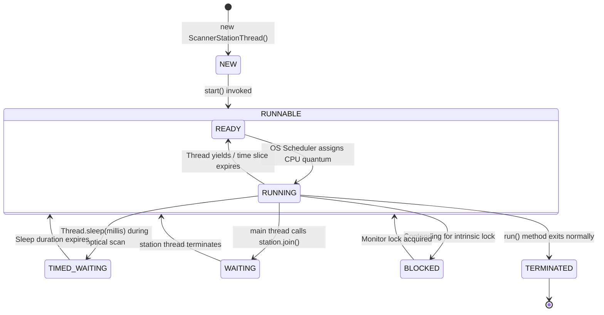

# Task 04: Thread Creation and the Thread Life Cycle

**Subject:** Programming in Java (CSA0914)  
**Bloom's Level:** K4 – Analyse  
**Marks:** 7 Marks  
**Repository:** `CSA0914-192511469-Assignment3`

---

## 1. Problem Overview
An institutional examination cell processes answer scripts across four independent scanning stations simultaneously. Each station is simulated as an asynchronous worker thread that scans batches of answer scripts, introducing simulated optical I/O pauses via `Thread.sleep()`, and records completion. The system must accurately compute the grand total of all scanned scripts across all stations without race conditions or premature aggregation.

---

## 2. Shared Group Work
### Dual Implementations: `Thread` vs. `Runnable`
1. **Extending `Thread` (`Task04/ScannerStationThread.java`):** Directly overrides `run()`, encapsulating both the thread identity and task execution within each station object.
2. **Implementing `Runnable` (`Task04/ScannerStationRunnable.java`):** Decouples the scanning workload from thread management, passing runnable task instances to worker threads (`new Thread(runnable, name)`).

---

## 3. Student A – Thread Design

### 3.1 Extending `Thread` vs. Implementing `Runnable`
| Feature | Extending `Thread` | Implementing `Runnable` (Preferred) |
|---|---|---|
| **Inheritance** | Consumes single class inheritance slot in Java | Class can extend other domain models (e.g., `StationBase`) |
| **Separation of Concerns** | Blends thread control logic with business logic | Pure task abstraction; execution decoupled from mechanics |
| **Reusability** | Cannot be submitted to thread pools (`ExecutorService`) | Directly compatible with `ExecutorService`, `ForkJoinPool` |
| **Composition** | Tightly coupled to JVM thread infrastructure | Clean composition over inheritance |
| **Recommendation** | Only when customizing thread behaviors (rare) | **Industry Standard Best Practice** |

### 3.2 Thread Life Cycle State Diagram

- **Station Thread States:** NEW $\rightarrow$ RUNNABLE $\rightarrow$ TIMED_WAITING (during `sleep()`) $\rightarrow$ RUNNABLE $\rightarrow$ TERMINATED.
- **Main Thread States:** RUNNABLE $\rightarrow$ WAITING (waiting on `station.join()`) $\rightarrow$ RUNNABLE (after station death) $\rightarrow$ TERMINATED.

### 3.3 Evidence: Calling `run()` vs. `start()`
Captured in `Logs/task04_start_vs_run.txt`:
```
Main Thread Details -> ID: 1, Name: 'main'

--- 1. Calling run() directly (NO NEW THREAD CREATED) ---
  Inside Task Body -> Thread ID: 1, Thread Name: 'main', Is Main Thread: true

--- 2. Calling start() (ASYNC NEW JVM THREAD SPAWNED) ---
  Inside Task Body -> Thread ID: 22, Thread Name: 'AsyncWorkerThread', Is Main Thread: false
```
**Conclusion:** Calling `run()` is a standard synchronous method invocation executed directly on the caller thread (`main`, ID: 1). Only `start()` instructs the JVM to allocate a new native OS thread, initialize its execution stack, and register it with the operating system kernel scheduler (yielding a distinct thread ID: 22).

### 3.4 Role of `join()` in Preventing Race Conditions
If `main()` attempted to compute `totalScripts += s.getScriptsScanned()` without calling `s.join()`:
- `main()` would execute concurrently while station threads were still in `TIMED_WAITING` or mid-scan.
- The resulting total would be unpredictable, premature, and incomplete (e.g. reporting 0 or 25 instead of 200).
- `join()` suspends the calling thread in the `WAITING` state until the target station thread transitions to `TERMINATED`, guaranteeing memory visibility and complete tallying.

---

## 4. Student B – Behavioural Experiments

### 4.1 Ten-Run Completion Order Observations
Measured across 10 consecutive runs with 4 stations (`ExperimentalData/task04_ten_runs.csv`):

| Run Number | 1st Station Finished | 2nd Station Finished | 3rd Station Finished | 4th Station Finished | Completion Order Pattern |
|---|---|---|---|---|---|
| **Run 1** | Station 3 | Station 2 | Station 1 | Station 4 | 3 $\rightarrow$ 2 $\rightarrow$ 1 $\rightarrow$ 4 |
| **Run 2** | Station 3 | Station 4 | Station 1 | Station 2 | 3 $\rightarrow$ 4 $\rightarrow$ 1 $\rightarrow$ 2 |
| **Run 3** | Station 1 | Station 3 | Station 2 | Station 4 | 1 $\rightarrow$ 3 $\rightarrow$ 2 $\rightarrow$ 4 |
| **Run 4** | Station 2 | Station 3 | Station 4 | Station 1 | 2 $\rightarrow$ 3 $\rightarrow$ 4 $\rightarrow$ 1 |
| **Run 5** | Station 1 | Station 2 | Station 4 | Station 3 | 1 $\rightarrow$ 2 $\rightarrow$ 4 $\rightarrow$ 3 |
| **Run 6** | Station 4 | Station 3 | Station 2 | Station 1 | 4 $\rightarrow$ 3 $\rightarrow$ 2 $\rightarrow$ 1 |
| **Run 7** | Station 1 | Station 4 | Station 3 | Station 2 | 1 $\rightarrow$ 4 $\rightarrow$ 3 $\rightarrow$ 2 |
| **Run 8** | Station 3 | Station 4 | Station 2 | Station 1 | 3 $\rightarrow$ 4 $\rightarrow$ 2 $\rightarrow$ 1 |
| **Run 9** | Station 4 | Station 2 | Station 1 | Station 3 | 4 $\rightarrow$ 2 $\rightarrow$ 1 $\rightarrow$ 3 |
| **Run 10** | Station 1 | Station 3 | Station 2 | Station 4 | 1 $\rightarrow$ 3 $\rightarrow$ 2 $\rightarrow$ 4 |

### 4.2 Thread Priority Experimentation
Captured in `Logs/task04_thread_priority.txt`:
```
=== THREAD PRIORITY EXPERIMENT ===
Starting threads simultaneously with priorities: High(10), Norm(5), Low(1)...
Observed Finish Order: [LowPriorityThread(1), NormPriorityThread(5), HighPriorityThread(10)]
```
- **Scheduler Insight:** In modern preemptive multitasking operating systems (Windows NT / Linux CFS), thread priority values (`1` to `10`) are advisory hints.
- Schedulers apply dynamic priority boosting to prevent starvation of low-priority threads. Therefore, a thread with `MIN_PRIORITY` can still finish before `MAX_PRIORITY` depending on core allocation and cache locality.

### 4.3 Daemon Thread Observation
Captured in `Logs/task04_daemon_thread.txt`:
```
Main thread waiting ONLY for userStation.join()...
  [UserStation-1] Scanned script 1
  [DaemonStation-2] (DAEMON) Archiving script batch #1
  [UserStation-1] Scanned script 2
  [DaemonStation-2] (DAEMON) Archiving script batch #2
  [UserStation-1] Scanned script 3
  [UserStation-1] COMPLETED normally.
[Main Thread] Exiting now. JVM will immediately terminate all active daemon threads!
```
- When all non-daemon user threads finish, the JVM halts execution immediately.
- The daemon thread is stopped mid-cycle without executing any `finally` blocks or closing remaining file handles.
- **Rule:** Never perform critical I/O, database writes, or transaction commits on daemon threads.

---

## 5. Joint Conclusion
**Why can the same multithreaded program produce different output orders on different runs, and why must a correct program not depend on that order?**
- Multithreaded execution order is non-deterministic because it depends on CPU core load, hardware interrupts, OS time-slice preemption, and memory bus contention.
- A correct concurrent program must be designed such that its safety, invariants, and results are mathematically invariant to thread scheduling interleavings. Program correctness must rely on explicit synchronization barriers (`join()`, `CountDownLatch`, monitors), never on timing assumptions or thread sleep durations.

---

## 6. Alternative Concept & Complexity Analysis: Thread Pool via `ExecutorService`
Implemented in `Task04/ScannerThreadPoolDemo.java`:
- Spawning $n$ raw `Thread` objects consumes $O(n)$ OS thread handles and native stack space.
- Default JVM 64-bit thread stack size is 1024 KB (1 MB). Creating 1,000 threads consumes ~1 GB of native RAM just for stack allocations, eventually crashing with `java.lang.OutOfMemoryError: unable to create native thread`.
- With a fixed pool of $p = 4$ worker threads:
  - **Memory:** Strict constant $O(p) = 4 \times 1\text{ MB} = 4\text{ MB}$ native stack overhead.
  - **Completion Time:** $T \approx \frac{n \times \text{cost}}{p}$ with near-linear parallel speedup and zero thread creation/destruction latency.
