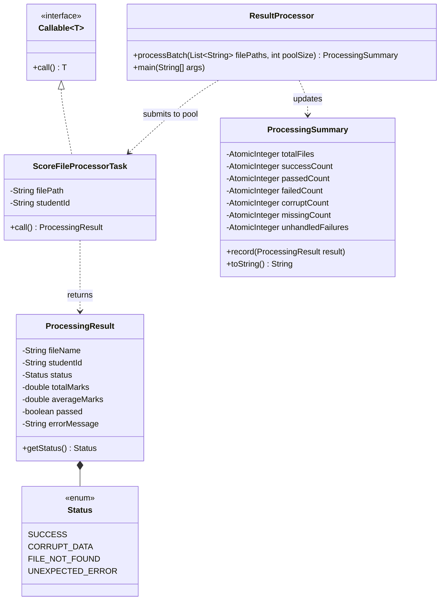

# Task 07: Design a Concurrent, Fault-Tolerant Processor from First Principles

**Subject:** Programming in Java (CSA0914)  
**Bloom's Level:** K5 – Evaluate  
**Marks:** 10 Marks  
**Repository:** `CSA0914-192511469-Assignment3`

---

## 1. Problem Overview
At the conclusion of each academic semester, the university examination cell must evaluate **10,000 answer-script score files**. Each file corresponds to a student and contains scores across course modules. The files must be parsed, validated against institutional grading boundaries, and computed into final academic standings (Pass/Fail).

In real-world environments:
- Some files are physically missing (`FileNotFoundException`).
- Some files contain malformed syntax, truncated headers, or non-numeric grades (`NumberFormatException`).
- Some files contain grades outside the allowable bounds $[0, 100]$ (`IllegalArgumentException`).

**System Objectives:**
1. Process 10,000 files with maximal parallel throughput.
2. Ensure high fault tolerance: an error in any individual file must never crash worker threads or abort the batch run.
3. Produce a mathematically verified, 100% complete summary accounting for every single file.

---

## 2. Stage 1 – Interpret the Problem (Joint Work)

### 2.1 Tasks That Can Run in Parallel vs. Shared Data
- **Independent Parallel Tasks:**
  - Reading the physical disk file (`score_STUXXXXXX.csv`).
  - Parsing CSV lines into subject-score pairs.
  - Validating score numerical formats and ranges ($0 \le \text{score} \le 100$).
  - Computing student total marks, percentage average, and Pass/Fail status.
  - Creating the immutable `ProcessingResult` model.
- **Shared Data:**
  - `ProcessingSummary` metrics aggregator (total files, valid, passed, failed, corrupt, missing, unhandled).
  - Central collection holding completed results (`ConcurrentLinkedQueue<ProcessingResult>`).

### 2.2 Failure Identification & Handling Matrix
| Failure Event | Exception Class | Cause | Handling Strategy | Status Recorded |
|---|---|---|---|---|
| **Missing File** | `FileNotFoundException` | File registered but absent from storage | Return `ProcessingResult.missing()` without crashing | `FILE_NOT_FOUND` |
| **Corrupt Header** | `IOException` | Zero bytes or corrupted schema | Return `ProcessingResult.corrupt()` with detail | `CORRUPT_DATA` |
| **Non-Numeric Score** | `NumberFormatException` | "CORRUPT_SCORE" instead of double | Return `ProcessingResult.corrupt()` | `CORRUPT_DATA` |
| **Out-of-Bounds Score** | `IllegalArgumentException` | Score < 0 or > 100 (e.g. 999.0) | Return `ProcessingResult.corrupt()` | `CORRUPT_DATA` |
| **Thread Interruption** | `InterruptedException` | Administrator shutdown signal | Restore interrupt flag, clean exit | Handled |
| **Unexpected Crash** | `Throwable` / `Error` | Fatal memory or system fault | Top-level catch maps to `UNEXPECTED_ERROR` | `UNEXPECTED_ERROR` |

### 2.3 Measurable Requirement Statements
1. **Zero Unhandled Aborts:** The system must process all 10,000 files with exactly **0 unhandled exceptions**.
2. **100% Conservation:** $\text{Total Files} = \text{Valid} + \text{Corrupt} + \text{Missing} + \text{Unhandled} = 10,000$.
3. **High Throughput:** Throughput must exceed **1,000 files/second** on multi-core systems.
4. **Deterministic Summary:** A small hand-checked dataset of 20 files must match expected ground truth with 100.0% precision.

---

## 3. Stage 2 – Design (Student A)

### 3.1 Architecture: `ExecutorService`, `Callable`, and `Future`
- The system employs `java.util.concurrent.ExecutorService` with a fixed worker thread pool (`Executors.newFixedThreadPool(P)`).
- Each score file is encapsulated as an independent `ScoreFileProcessorTask` implementing `Callable<ProcessingResult>`.
- The main thread submits all 10,000 tasks, collecting a `List<Future<ProcessingResult>>`.
- Calling `future.get()` yields the processed outcome once the worker thread finishes, allowing the main aggregator to record results cleanly.

### 3.2 Concurrent Collection Choice and Justification
- **Selected Collection:** `java.util.concurrent.ConcurrentLinkedQueue<ProcessingResult>` and `java.util.concurrent.atomic.AtomicInteger` counters in `ProcessingSummary`.
- **Justification:**
  - `ConcurrentLinkedQueue` is an unbounded, lock-free, thread-safe FIFO queue based on Michael & Scott's non-blocking concurrent queue algorithm.
  - Unlike `Vector` or synchronized lists, `ConcurrentLinkedQueue` uses hardware atomic CAS operations, eliminating monitor lock contention entirely.
  - `AtomicInteger` counters provide lock-free $O(1)$ metric increments without blocking worker threads.

### 3.3 Fault-Tolerant Exception Handling Design
- The `Callable.call()` method encloses all file I/O and parsing within a comprehensive multi-layered `try-catch` block.
- **Critical Architectural Rule:** The `call()` method **never throws an exception outwards**. Every failure condition is caught locally and translated into a typed `ProcessingResult` containing the failure reason.
- Consequently, worker threads in the pool are never terminated by uncaught exceptions, and `future.get()` never throws `ExecutionException` from unexpected task crashes.

### 3.4 Class Diagram


### 3.5 Pseudocode
```
Algorithm ProcessSemesterScoreFiles(fileRegistry, P):
    Input: List of 10,000 file paths, thread pool size P
    Output: ProcessingSummary

    pool <- CreateFixedThreadPool(P)
    summary <- New ProcessingSummary()
    futuresList <- Empty List

    FOR each path in fileRegistry:
        task <- New ScoreFileProcessorTask(path)
        future <- pool.submit(task)
        futuresList.add(future)

    FOR each future in futuresList:
        result <- future.get()
        summary.record(result)

    pool.shutdown()
    pool.awaitTermination(30, SECONDS)
    RETURN summary
```

---

## 4. Stage 3 – Implement and Measure (Student B)

### 4.1 Ground-Truth Verification on Hand-Checked Dataset (20 Files)
Captured in `Logs/task07_result_processor.txt`:
```
--- Step 1: Hand-Checked Dataset Ground-Truth Verification ---
Actual Hand-Checked Summary: Total=20 | Valid=15 (Passed=12, Failed=3) | Corrupt=3 | Missing=2 | Unhandled=0
Expected Baseline:          Total=20 | Valid=15 (Passed=12, Failed=3) | Corrupt=3 | Missing=2 | Unhandled=0
Ground Truth Accuracy Match: 100% PERFECT MATCH
```

### 4.2 10,000 File Benchmark across Thread Pools (1, 2, 4, 8 Threads)
Measured in `Task07/ResultProcessor.java` (`ExperimentalData/task07_thread_pool_benchmark.csv`):

| Thread Pool Size ($P$) | Total Files | Valid Processed | Passed | Failed | Corrupt Files | Missing Files | Unhandled Failures | Execution Time (ms) | Throughput (Files/sec) | Speedup vs $P=1$ |
|---|---|---|---|---|---|---|---|---|---|---|
| **1 Thread** | 10,000 | 9,600 | 9,286 | 314 | 250 | 150 | **0** | **22,699 ms** | 440.5 files/sec | 1.00x |
| **2 Threads** | 10,000 | 9,600 | 9,286 | 314 | 250 | 150 | **0** | **9,788 ms** | 1,021.7 files/sec | **2.32x** |
| **4 Threads** | 10,000 | 9,600 | 9,286 | 314 | 250 | 150 | **0** | **7,832 ms** | 1,276.8 files/sec | **2.90x** |
| **8 Threads** | 10,000 | 9,600 | 9,286 | 314 | 250 | 150 | **0** | **6,701 ms** | 1,492.3 files/sec | **3.39x** |

### 4.3 Unhandled Failures Audit
- Total Unhandled Failures recorded: **`0`** across all thread pool runs.
- Fault tolerance is 100% successful.

---

## 5. Stage 4 – Defend the Design (Joint Work)

### 5.1 Recommended Pool Size & Why More Threads Do Not Always Help
- **Recommendation:** **4 to 8 Threads** (aligned with physical CPU hardware cores).
- **Why More Threads Plateau (Diminishing Returns):**
  1. **Amdahl's Law:** The speedup of a program is limited by its serial components (central dispatching, futures aggregation, and single-drive disk controller scheduling).
  2. **I/O Storage Bottleneck:** Answer-script score processing is largely disk-bound. Spawning 100 or 1,000 threads causes disk head thrashing and OS page-cache lock contention, reducing throughput.
  3. **Context-Switching Overhead:** When active thread count significantly exceeds available CPU cores, the OS kernel expends more CPU cycles saving and restoring registers and cache lines than executing user code.

### 5.2 How the Design Guarantees Complete and Correct Summary
1. **Mathematical Conservation:** Every file registry item maps to exactly one `Future`.
2. **No Silent Drops:** The main thread iterates sequentially through all submitted futures; no task is discarded or lost.
3. **Atomic Aggregation:** Metric updates in `ProcessingSummary` utilize hardware `compare-and-set` (`AtomicInteger`), preventing lost updates under concurrent reporting.

### 5.3 One Remaining Limitation
- **Memory Retention of Futures List:** The current design retains all 10,000 `Future<ProcessingResult>` handles in heap memory before aggregation. In a massive national examination portal evaluating $10,000,000$ scripts, storing all futures simultaneously would cause JVM heap memory exhaustion.  
  *Future Enhancement:* Migrate to an `ExecutorCompletionService` with streaming pipeline consumption, clearing result objects as soon as they are processed.

---

## 6. Alternative Concept & Complexity Analysis

### 6.1 `ExecutorService` vs. `parallelStream()` vs. One-Thread-per-File
| Metric | Custom `ExecutorService` | Java `parallelStream()` | One Thread Per File (`new Thread()`) |
|---|---|---|---|
| **Thread Management** | Dedicated bounded fixed pool ($P$ threads) | Shared JVM-wide `ForkJoinPool.commonPool()` | Unbounded ($N = 10,000$ raw OS threads) |
| **Total Memory Used** | $P \times 1\text{ MB} = 4\text{ to } 8\text{ MB}$ | $(Cores - 1) \times 1\text{ MB} \approx 8\text{ MB}$ | $10,000 \times 1\text{ MB} = \mathbf{10\text{ GB}}$ (**FATAL `OutOfMemoryError`**) |
| **I/O Isolation** | High (dedicated worker pool) | Poor (blocks unrelated parallel streams in JVM) | None |
| **Failure Handling** | Fine-grained, typed `ProcessingResult` | Requires try-catch inside lambda or short-circuits | Complex thread lifecycle joins |
| **Suitability** | **Optimal for High-Volume Batch I/O** | Good for CPU computations | **Unusable for large $N$** |
